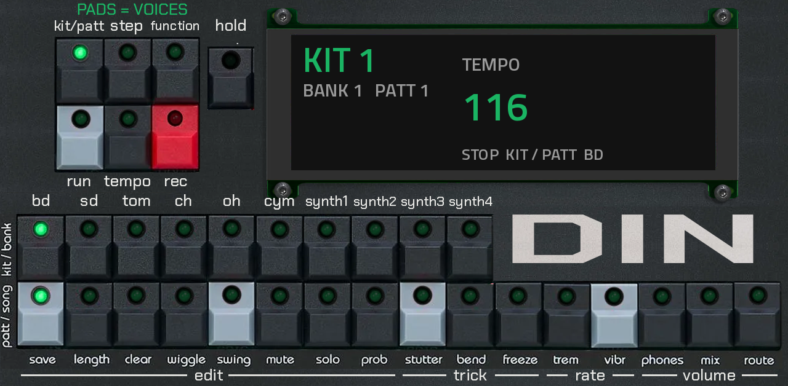
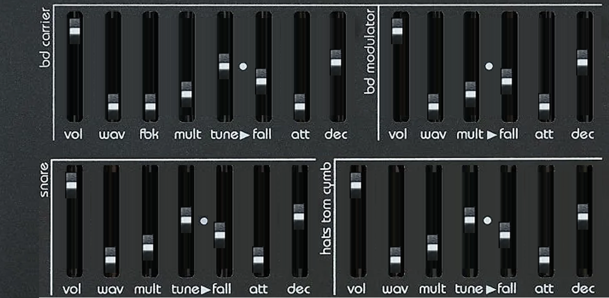
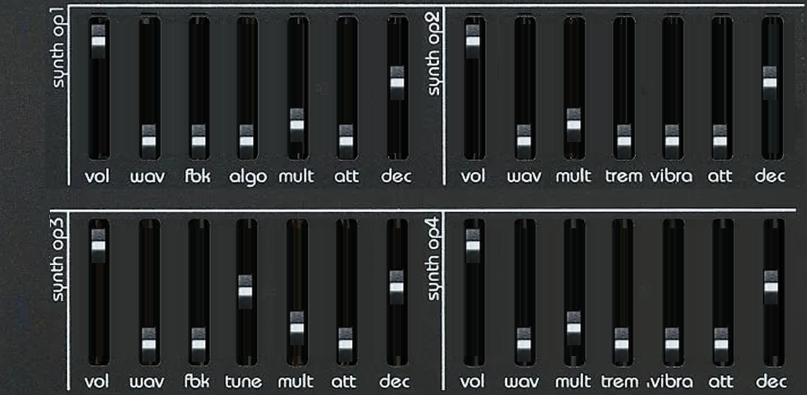

# DINXXL v1.0.0

**Twisted Electrons' BlastBeats, the OPL3 FM drum machine and groovebox, running as a plugin on the Akai Force: the real
firmware (v7.1) on a software model of the board, so every mode, trick, fader law, lamp and sequencer quirk is the
machine's own. Only the skin changes.**

DINXXL is a VST2 instrument for MPC OS's built-in plugin host, made by L'Cronx. It is not a re-creation of BlastBeats:
the published BlastBeats firmware source is compiled into the plugin unchanged and runs on a virtual board (the YMF262
sound chip, the 56 faders, the 32 keys, the LED matrix, the headphone and line amplifiers, the SD card and EEPROM, the
timers). What you play is the firmware playing its own hardware; the plugin only paints the panel, moves the lamps, hands
the faders and keys to the firmware and takes the chip's output to the Force's mixer.

> [!NOTE]
> **Status: 1.0.0, built for the Force (MPC OS 3.x).** It passes its engine tests (boot from the factory card, step
> programming, p-locks, run with lamp chase, host transport follow, state save and restore) and has been tried on a
> Force while it was built; expect rough edges and please report them. What is not done is listed under
> *What is different* and *Not yet*.



## The machine

BlastBeats is a 10-voice FM groovebox built around a Yamaha YMF262 (OPL3) in rhythm mode:

- **Six drum voices**: BD (a two-operator voice, carrier and modulator on their own fader rows), SD, tom, closed hat,
  open hat, cymbal.
- **Four synth voices**, each a four-operator FM voice with the OPL3's algorithms, waveform per operator, feedback,
  tremolo and vibrato.
- **56 faders** of sound shaping, read exactly as the firmware reads its hardware faders (16 levels per fader, waveform
  = level ÷ 2, algorithm = level × 4 ÷ 15).
- **A 16-step sequencer** with 64 steps over four pages, 10 voice rows, parameter locks, automation, probability, nudge,
  swing, key change and pattern chaining into songs; 16 patterns per bank, kits and patterns saved to the card.
- **Mode keys** KIT/PATT, STEP, FUNCTION, TEMPO, REC and RUN, and the sixteen function-row tricks under the step keys:
  save, length, clear, wiggle, swing, mute, solo, prob (edit), stutter, bend, freeze (trick), trem, vibr (rate), phones,
  mix, route (volume).

DINXXL does not describe any of this in its own code. Every one of those features is the firmware's; the manual that
applies is BlastBeats' manual (in the upstream repository under `manual/`).

## On the screen

Three pages, switched with the Force's page tabs:

- **KEYS** — the mode keys, the ten voice keys, the sixteen step keys with their function-row names, and the screen.
  Each key has its lamp; the lamps are the firmware's LED matrix, so they chase with the sequencer, blink where the
  machine blinks, and show the step page, the selected voice, mutes, solos and the rest exactly as the hardware does.
  The REC lamp is red; everything else lights `#1ab463`.
- **DRUMS** — the 28 drum faders in their four groups (BD carrier, BD modulator, snare, hats/tom/cymb).
- **SYNTH** — the 28 synth faders (op 1 ... op 4). They edit the synth voice last selected with a voice key, as on the
  machine.

The screen is the plugin's addition (the hardware has only lamps): large live text in the Force's own renderer. At rest
it shows the kit, bank and pattern, the tempo, the mode and the selected voice (Home). Touch a fader and it shows that
fader's voice, name and value for two seconds; WAV shows the OPL3 waveform as a picture, ALGO draws the four-operator
algorithm with carriers in green and modulators in grey. A key press shows the key's name. It returns Home by itself.



## Keys: how a tap works

MPC OS sends a plugin one event per tap of a skin button, not press-and-release. DINXXL turns that into firmware key
events like this:

- **Every key is momentary**: a tap is a 12 ms press, long enough for the firmware's key scan, short enough to feel
  instant. That includes the five mode keys (KIT/PATT, STEP, FUNCTION, TEMPO, REC) and RUN. The firmware switches mode on
  the release of a mode key, so a tap does exactly what letting go of the key does on the machine.
- **HOLD** (the key beside the screen) makes the next voice or step key you tap stay down until you tap it again, which
  is how combinations that need a key held (a step held while a voice key is tapped, for parameter locks) are reached from
  single taps. The screen shows what is held.
- **RUN** starts and stops the internal sequencer. When the Force transport drives the plugin, RUN stops the sequencer.

## Playing it from the Force

- **Transport:** the plugin follows the Force's play/stop and tempo clock (24 PPQN), so the sequencer runs in time with the
  project.
- **MIDI:** channel 10 plays the drum voices on the firmware's own notes, channels 1-4 the four synths, exactly as the
  machine's MIDI input does.
- **PADS = VOICES** (switch above the HOLD key): the 16 Force pads each play one voice (not chromatic), in the order
  BD, SD, tom, CH, OH, cymbal, synth 1-4 and the step keys' voices.

## What is different from the hardware

- **The card is inside the plugin.** BlastBeats' factory card (kits, patterns, songs) ships in the package and is the
  machine's SD card at first start. The firmware's SD card and EEPROM live in memory and are saved with the Force
  project as the *difference* from the factory card (usually about 1 KB), so your kits, patterns and settings travel
  with the project. The firmware's own SAVE still works.
- **The faders follow the kit.** The real machine's faders are physical and stay put when a kit loads; the panel's
  faders move to the loaded kit's values (and to the selected synth or drum voice's).
- **Mute is the firmware's mute**: it stops the sequencer firing a voice. Notes played by hand or sent over MIDI still
  sound, as on the machine.
- **One instance is the machine.** The firmware is one set of global state, so the first DINXXL in a project is the
  machine and any further instance is silent. Use one.
- **USB, the firmware updater, the VGM player, the serial link and SysEx are not connected.** The plugin host forwards
  3-byte MIDI only, so the BlastBeats web tool's SysEx protocol cannot reach it.
- **Not yet:** an editor for moving patches between a PC and the plugin, voice-select and modifier keys on the fader
  pages, and context pages on the screen beyond key names.
- **Diagnostics.** `card/dinxxl.log` (in the plugin folder) gets one line every 5 seconds: CPU, worst block time, key and
  MIDI counts, mode, tempo. Attach it to a bug report.
- **Output level.** The hardware mixes the OPL3's four outputs into a stereo pair through its amplifier chips. DINXXL
  mixes L = A + C and R = B + D (the board's routing) and scales so a full-volume drum peaks around −8 dBFS before a
  soft limiter that keeps dense kits from clipping. The level is set by ear against the chip's numbers, not against a
  measured BlastBeats; if it is off, the gain is one constant in `src/engine.cc`.
- **CPU.** About 2 % of one x86 core in the test harness; on the Force the log shows the real figure.



## Install

Download the zip from Releases and follow its `INSTALL.md` (the installer stops and restarts MPC).

## Build

```
git clone --recurse-submodules https://github.com/sunskiefer/dinxxl
cd dinxxl
pip install pillow playwright ziglang && python3 -m playwright install chromium
./build.sh            # -> build/package/L'Cronx - VST - DINXXL  (skin + dinxxl.so)
```

`build.sh` regenerates the parameters (`tools/gen_params.py` → `params.json`, `src/param_ids.h`, `layout.conf`), the
page art (`tools/make_art.py`, from the photographs in `art/src/`), the browser tile, the skin (the framework's
`gen_vst.py` with its HTML renderer) and then cross-compiles with Zig for armv7-a hard-float against glibc 2.31. The skin uses the MPC OS 3.x skin format,
so the package is for MPC OS 3.x (Force, MPC X/Live/One). The output exports `VSTPluginMain` only. Nothing in the build is for the desktop;
`test/` is a developer harness that runs the same engine natively.

Layout: `src/fw/` is the BlastBeats firmware as published (see its `VENDORED.md`), `src/shim/` and `src/hw.cpp` are the
board, `src/dsp/` is the ymfm YMF262 core (its `VENDORED.md`), `src/engine.cc` is the plugin: parameters, keys, lamps,
screen and state, built on the [mpc-vst-plugins](https://github.com/sd88me/mpc-vst-plugins) framework.

## The panel art

The key, fader and lamp images are photographs of generic parts, the kind of tactile keys, fader caps and LEDs sold by
any electronics supplier; nothing on the panel is Twisted Electrons' artwork, logo or wordmark, and the DIN mark is
L'Cronx's own. The screen's baked text and the frame titles use **Chakra Petch** (Cadson Demak), under the SIL Open
Font License 1.1 (`art/fonts/OFL.txt`); the live screen text is drawn by MPC OS in its own font.

## Credits and licence

- **BlastBeats** is designed and made by [Twisted Electrons](https://twisted-electrons.com); the firmware is theirs
  (https://github.com/twistedelectrons/BlastBeats, v7.1, commit `9b562d0`), used here unmodified in `src/fw/` with its
  copyright notices. DINXXL is not made or endorsed by Twisted Electrons. If you like this, buy the machine: the plugin is a
  tribute to it, not a replacement for it.
- The firmware vendors the Arduino OPL2 library (Maarten Janssen, MIT), uClock (Romulo Silva, MIT) and miniz (MIT); see
  `src/fw/THIRD_PARTY_NOTICES.md`.
- The YMF262 emulation is **ymfm** by Aaron Giles, BSD-3-Clause (`src/dsp/LICENSE-ymfm`).
- **DINXXL** (the board model, shims, plugin glue, tools and panel art) is by **L'Cronx** (Croydon, UK), licensed
  **GPL-3.0-or-later** (`LICENSE`). See `NOTICE`.
- **Firmware licence note.** The BlastBeats repository is public but declares no licence for its own code. It is
  redistributed here, credited and unmodified, as part of a free tribute port; if Twisted Electrons ask for it to be
  removed or relicensed, it will be.
